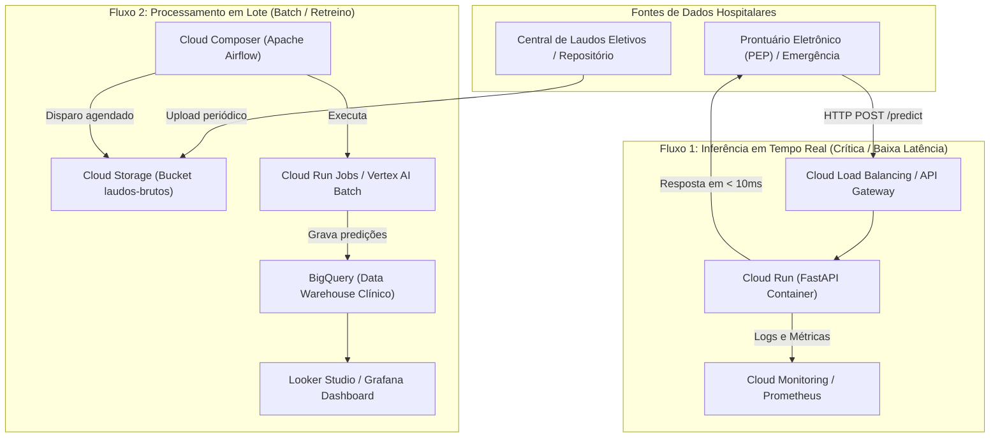

# Tech Challenge - Fase 3 | Machine Learning Engineering (FIAP)
## Deploy de Modelo em Produção: Triagem Automática de Laudos Médicos com NLP

Sistema de triagem automática de laudos e exames médicos textuais para classificação de condições clínicas e urgência hospitalar. O projeto contempla o ciclo de vida completo de MLOps: decisão arquitetural em nuvem, API REST de baixa latência, conteinerização Docker, automação CI/CD (GitHub Actions), orquestração de retreino (Airflow), observabilidade (Prometheus + Grafana) e otimização de latência (ONNX).

---

## 1. Contexto do Desafio e Problema Clínico

Em hospitais e centros de diagnóstico de alta demanda, a triagem manual de laudos clínicos e exames pode gerar gargalos críticos no atendimento. A automação inteligente desse fluxo auxilia a priorizar exames graves (como neoplasias e eventos cardiovasculares agudos) frente a condições eletivas ou gerais.

O modelo é treinado para classificar o texto do laudo (`medical_abstract`) em 5 condições clínicas:
1. **Neoplasms** (Neoplasias / Tumores)
2. **Digestive system diseases** (Doenças do Aparelho Digestivo)
3. **Nervous system diseases** (Doenças do Sistema Nervoso)
4. **Cardiovascular diseases** (Doenças Cardiovasculares)
5. **General pathological conditions** (Condições Patológicas Gerais)

---

## 2. Decisão Arquitetural em Nuvem: Google Cloud Platform (GCP)

Conforme os requisitos da **Etapa 1**, avaliamos a infraestrutura em nuvem ideal considerando o ecossistema da **Google Cloud Platform (GCP)**. A análise abrange as duas modalidades essenciais de inferência: **Tempo Real (Real-Time / Online)** e **Processamento em Lote (Batch)**.



---

### 2.1. Estratégia 1: Inferência em Tempo Real (Real-Time Serving)

#### Cenário Hospitalar
* **Casos de uso:** Atendimento em pronto-socorro, unidades de terapia intensiva (UTI) e triagem imediata no momento da digitação do laudo pelo médico ou técnico.
* **Requisitos:** Latência estrita (SLO de resposta $P95 < 50 \text{ ms}$), disponibilidade contínua (99.9%), alta concorrência e retorno imediato da probabilidade de risco.

#### Opções Avaliadas no GCP
1. **Google Cloud Run (Opção Recomendada):**
   * **Conceito:** Plataforma serverless totalmente gerenciada para execução de contêineres OCI (Open Container Initiative).
   * **Vantagens:**
     * **Escalonamento de 0 a centenas de instâncias:** Não há custos ociosos durante madrugadas com baixa demanda.
     * **Cold Start mínimo (< 1 segundo):** Para modelos leves baseados em Scikit-Learn/FastAPI em Python slim, o tempo de inicialização é imperceptível.
     * **Cobrança granular por requisição e por 100 ms de CPU/RAM utilizada.**
     * **Integração nativa:** Compatível diretamente com o `Dockerfile` da aplicação, Google Artifact Registry e Cloud IAM.
     * **Suporte a Tráfego Dividido (Traffic Splitting):** Permite deploy canário (ex.: 90% versão estável / 10% nova versão) sem downtime.
   * **Limitações:** Limite máximo de requisição de 60 minutos (irrelevante para inferências de milissegundos).

2. **Google Kubernetes Engine (GKE):**
   * **Conceito:** Cluster Kubernetes gerenciado corporativo.
   * **Vantagens:** Controle total sobre rede, topologia de pods, service mesh (Istio) e autoscaling customizado (KEDA/HPA).
   * **Desvantagens:** Alto custo mínimo fixo (mesmo com cluster ocioso), alta sobrecarga de governança e complexidade operacional desnecessária para o volume de um único classificador leve de texto.

3. **Vertex AI Endpoints:**
   * **Conceito:** Plataforma MLOps gerenciada do GCP para serving de modelos.
   * **Vantagens:** Gerenciamento nativo de artefatos de modelo, monitoramento de data drift e explicabilidade (Explainable AI).
   * **Desvantagens:** Custo mínimo de nó dedicado 24/7 (não escala nativamente a zero sem latência considerável) e empacotamento restrito a pre-built containers ou custom prediction routines com maior curva de setup.

> **Decisão para Tempo Real:** **Google Cloud Run**. Oferece a melhor relação de custo-benefício, simplicidade operacional com base no `Dockerfile` padrão do projeto e latência de rede mínima para chamadas HTTP REST do Prontuário Eletrônico do Paciente (PEP).

---

### 2.2. Estratégia 2: Processamento em Lote (Batch Inference)

#### Cenário Hospitalar
* **Casos de uso:** Classificação em massa de laudos emitidos nos últimos 30 dias para auditoria clínica, controle de qualidade, cobrança hospitalar (faturamento SUS/convênios) e pipeline de retreino periódico.
* **Requisitos:** Alto throughput (milhares de laudos por execução), baixo custo por amostra processada, sem necessidade de resposta síncrona imediata.

#### Opções Avaliadas no GCP
1. **Cloud Composer (Apache Airflow Gerenciado) + Cloud Run Jobs (Opção Recomendada):**
   * **Conceito:** DAGs do Airflow orquestram as tarefas de leitura de lotes de laudos no **Google Cloud Storage (GCS)**, acionam a execução de tarefas efêmeras no **Cloud Run Jobs** e salvam as predições no **BigQuery**.
   * **Vantagens:**
     * O Cloud Composer atende de forma nativa ao requisito obrigatório de orquestração via Airflow do Tech Challenge.
     * O Cloud Run Jobs é instanciado apenas durante a execução do lote e desligado imediatamente após a conclusão, sem custos de máquina ligada 24/7.
     * Escalabilidade horizontal massiva para processar milhões de registros em minutos.

2. **Vertex AI Batch Prediction:**
   * **Conceito:** Serviço nativo do Vertex AI para submissão de predições em lote a partir de arquivos CSV/JSONL no GCS.
   * **Vantagens:** Totalmente gerenciado, sem necessidade de manter código de batch customizado.
   * **Desvantagens:** Menor flexibilidade para encadear passos complexos de pré-processamento de regras de negócio antes e depois da inferência sem acoplar a uma pipeline de componentes Kubeflow.

3. **BigQuery ML:**
   * **Conceito:** Inferência diretamente dentro do data warehouse via comandos SQL (`ML.PREDICT`).
   * **Vantagens:** Velocidade analítica extrema para dados já residentes no BigQuery.
   * **Desvantagens:** Requer conversão e registro do modelo no BigQuery, limitando a reutilização direta do pipeline em Python/Scikit-Learn construído para a API.

> **Decisão para Lote:** **Cloud Composer (Airflow) + Google Cloud Storage (GCS) + Cloud Run Jobs + BigQuery**. Permite reaproveitar o mesmo contêiner Docker da aplicação para inferência em larga escala, garantindo paridade de código entre treino, batch e tempo real.

---

### 2.3. Matriz de Decisão Comparativa

| Critério de Avaliação | Tempo Real (Cloud Run) | Processamento em Lote (Cloud Run Jobs + Airflow) |
| :--- | :---: | :---: |
| **Gatilho de Execução** | Requisição HTTP REST síncrona (Event-driven) | Agendamento cronológico ou chegada de arquivo no GCS |
| **Latência por Amostra** | $< 5 \text{ ms}$ (modelo) / $< 50 \text{ ms}$ (total HTTP) | Segundos a minutos (foco em throughput consolidado) |
| **Modelo de Cobrança** | Por requisição e por 100 ms de CPU alocada | Por tempo de execução do job efêmero |
| **Escala a Zero** | Sim (Zero custo quando ocioso) | Sim (Recursos alocados apenas durante o job) |
| **Destino dos Dados** | Retorno imediato no payload JSON para o cliente | Persistência colunar no BigQuery para analytics e BI |
| **Orquestrador Central** | Cloud Load Balancing / API Gateway | Cloud Composer (Apache Airflow) |

---

### 2.4. Arquitetura Integrada Recomendada (Produção)

A arquitetura hospitalar adota um padrão híbrido (**dual-path**):

1. **Path Rápido (Online):** O sistema hospitalar dispara `POST /predict` para a API FastAPI hospedada no **Cloud Run**. O modelo leve (serializado em `baseline_model.joblib`) responde em milissegundos com a classe predita e o nível de confiança.
2. **Path Lento (Batch & Retreino):** Arquivos consolidados de exames são depositados em baldes do **Cloud Storage**. Uma DAG do **Airflow** dispara semanalmente a validação de performance do modelo e gera inferências consolidadas no **BigQuery**.
3. **Observabilidade Unificada:** A API expõe o endpoint `/metrics` utilizando `prometheus-client`. Em ambiente local e de homologação, o **Prometheus** raspa as métricas e as renderiza em dashboards no **Grafana**. Na nuvem, as métricas podem ser encaminhadas ao **Cloud Monitoring**.
4. **Pipeline CI/CD:** Todo `push` na branch `main` executa linters e testes unitários no **GitHub Actions**, gerando a imagem Docker no **Artifact Registry** e realizando o deploy contínuo no **Cloud Run**.

---

## 3. Estrutura do Repositório

```text
├── .github/
│   └── workflows/          # Workflows CI/CD (lint, testes, build)
│       └── ci.yml
├── dags/                   # DAGs do Apache Airflow
│   └── medical_retrain_dag.py # Pipeline de ingestão, retreino e promoção
├── docs/                   # Documentação complementar e diagramas
├── models/
│   ├── baseline_model.joblib  # Pipeline treinado (TF-IDF + Classificador)
│   └── classes_mapping.json   # Metadados e mapeamento de categorias
├── monitoring/             # Stack de Observabilidade e Métricas
│   ├── grafana/
│   │   ├── dashboards/     # Dashboard JSON com os 3 painéis obrigatórios
│   │   │   └── medical_triage_dashboard.json
│   │   └── provisioning/   # Configuração automática do datasource e dashboards
│   │       ├── dashboards/dashboard_provider.yml
│   │       └── datasources/prometheus_datasource.yml
│   └── prometheus/
│       └── prometheus.yml  # Configuração de scraping da API a cada 5s
├── notebooks/
│   └── eda.ipynb           # Análise Exploratória e Modelagem de NLP
├── raw_data/
│   ├── medical_tc_labels.csv  # Mapeamento oficial dos rótulos clínicos
│   ├── medical_tc_train.csv   # Dataset de treino (11.550 amostras)
│   └── medical_tc_test.csv    # Dataset de teste (2.888 amostras)
├── src/
│   ├── __init__.py
│   ├── api/                # Serviço REST com FastAPI
│   │   ├── __init__.py
│   │   ├── config.py       # Configurações de ambiente e aplicação
│   │   ├── metrics.py      # Instrumentação de telemetria Prometheus
│   │   ├── model.py        # Serviço desacoplado de inferência
│   │   ├── schemas.py      # Schemas Pydantic de entrada e saída
│   │   └── main.py         # Endpoints FastAPI e ciclo de vida
│   └── pipelines/          # Módulos de engenharia de dados e retreino
│       ├── __init__.py
│       └── training_pipeline.py # Funções desacopladas do pipeline de ML
├── tests/                  # Testes automatizados e benchmarks
│   ├── __init__.py
│   ├── benchmark_latency.py # Script de medição de latência local
│   ├── generate_traffic.py  # Gerador de tráfego para teste do Grafana
│   ├── latency_baseline.json# Registro das métricas de latência
│   ├── test_airflow_dag.py  # Teste end-to-end do pipeline da DAG
│   └── test_api.py         # Testes de integração dos endpoints
├── .dockerignore           # Exclusão de arquivos pesados na imagem
├── .gitignore
├── config.yaml             # Configurações gerais da aplicação
├── docker-compose.yml      # Stack completa: API + Prometheus + Grafana
├── Dockerfile              # Empacotamento Docker da API (não-root)
├── requirements.txt        # Dependências do projeto
└── README.md               # Documentação técnica e arquitetural
```

---

## 4. Como Executar o Projeto Localmente

### 4.1. Pré-requisitos
* Python 3.10+ instalado
* Git instalado
* Docker e Docker Compose instalados

### 4.2. Instalação do Ambiente Virtual
```bash
# Clonar o repositório
git clone <url-do-repositorio>
cd fase3

# Criar ambiente virtual
python -m venv .venv

# Ativar ambiente (Windows)
.venv\Scripts\activate
# Ativar ambiente (Linux/Mac)
source .venv/bin/activate

# Instalar dependências
pip install -r requirements.txt
```

### 4.3. Executando a Análise Exploratória (Notebook)
```bash
jupyter notebook notebooks/eda.ipynb
```

### 4.4. Executando a API FastAPI Localmente
```bash
uvicorn src.api.main:app --host 0.0.0.0 --port 8000 --reload
```
Acesse a documentação interativa OpenAPI (Swagger) em: [http://localhost:8000/docs](http://localhost:8000/docs).

### 4.5. Executando os Testes Automatizados
```bash
# Executa todos os testes (API e pipeline da DAG)
pytest tests/ -v

# Ou via unittest
python -m unittest tests/test_api.py -v
python -m unittest tests/test_airflow_dag.py -v
```

### 4.6. Medindo o Baseline de Latência Local
```bash
python tests/benchmark_latency.py --requests 300
```

### 4.7. Construção e Execução via Docker
```bash
# Construir a imagem Docker leve da API
docker build -t medical-triage-api:v1 .

# Executar o container expondo a porta 8000
docker run -d -p 8000:8000 --name triage-api medical-triage-api:v1

# Testar o status de saúde do container
# Linux/Mac (Bash):
curl http://localhost:8000/health
# Windows (PowerShell):
Invoke-RestMethod http://localhost:8000/health

# Testar inferência via container
# Opção A: Windows PowerShell (Nativo)
$body = @{
    medical_abstract = "Patient admitted with severe chest pain, elevated cardiac enzymes and ST-segment elevation on ECG confirming acute myocardial infarction."
} | ConvertTo-Json

Invoke-RestMethod -Uri http://localhost:8000/predict -Method Post -Body $body -ContentType "application/json"

# Opção B: Linux/Mac (Bash / cURL)
curl -X POST http://localhost:8000/predict \
     -H "Content-Type: application/json" \
     -d '{"medical_abstract": "Patient admitted with severe chest pain, elevated cardiac enzymes and ST-segment elevation on ECG confirming acute myocardial infarction."}'
```

### 4.8. Executando a Stack de Observabilidade Completa (API + Prometheus + Grafana)
A stack oficial da **Etapa 3** sobe a aplicação instrumentada com coleta de métricas e dashboards pré-configurados:

```bash
# 1. Subir toda a stack em segundo plano
docker compose up -d

# 2. Gerar requisições clínicas sintéticas para alimentar os gráficos do Grafana
python tests/generate_traffic.py

# 3. Acessar os serviços no navegador:
# - API FastAPI:    http://localhost:8000/docs
# - Métricas raw:   http://localhost:8000/metrics
# - Prometheus UI:  http://localhost:9090
# - Grafana UI:     http://localhost:3000 (Login: admin / Senha: admin)
```

#### Evidências Visuais de Execução
Abaixo estão os registros visuais das ferramentas em execução durante a validação da solução:

**1. Dashboard de Monitoramento no Grafana (Etapa 3):**


**2. Pipeline de Retreino no Apache Airflow (Etapa 2):**


---

## 5. Baseline de Latência Local (Etapa 1)

Medição realizada sobre 300 requisições individuais com amostras reais do conjunto de teste (`medical_tc_test.csv`):

| Métrica de Performance | Valor Medido | Observações |
| :--- | :---: | :--- |
| **Total de Requisições** | 300 | Amostras variadas de laudos clínicos |
| **Taxa de Sucesso / Erro** | 100% / 0.0% | Sem quedas ou exceções durante o benchmark |
| **Throughput Médio** | **261.27 req/s** | Capacidade de resposta em thread síncrona local |
| **Latência Média** | **3.68 ms** | Tempo total de ciclo (rede local + parsing + inferência) |
| **Latência P50 (Mediana)** | **3.44 ms** | Tempo de resposta para 50% dos laudos |
| **Latência P90** | **4.71 ms** | Percentil 90 |
| **Latência P95** | **5.28 ms** | Percentil 95 (referência para SLO hospitalar) |
| **Latência P99** | **8.35 ms** | Percentil 99 |
| **Latência Mínima / Máxima**| 2.16 ms / 13.92 ms | Sem spikes representativos de cold start |

---

## 6. Otimização de Latência: Scikit-Learn vs. ONNX Runtime (Etapa 4)

Conforme a **Etapa 4**, o classificador de texto foi exportado para o formato padrão da indústria **ONNX** (`models/model_optimized.onnx`) e executado através do runtime compilado em C++ **ONNX Runtime (CPUExecutionProvider)**.

O benchmark comparativo oficial avaliou **500 laudos clínicos reais** sob as mesmas condições de CPU:

| Métrica de Desempenho | Scikit-Learn (Original) | ONNX Runtime (Otimizado) | Melhoria Alcançada |
| :--- | :---: | :---: | :---: |
| **Latência Média** | **2.912 ms** | **0.402 ms** | **7.24x mais rápido (-86.2%)** |
| **Latência Mediana (P50)**| **2.895 ms** | **0.418 ms** | **6.93x mais rápido (-85.6%)** |
| **Latência P90** | **3.787 ms** | **0.513 ms** | **7.38x mais rápido (-86.5%)** |
| **Latência P95 (SLO)** | **4.010 ms** | **0.598 ms** | **6.71x mais rápido (-85.1%)** |
| **Latência P99** | **4.370 ms** | **0.739 ms** | **5.91x mais rápido (-83.1%)** |
| **Throughput Máximo** | **342.7 req/s** | **2.467.4 req/s** | **+2.124 req/s (+620%)** |
| **Paridade de Predição** | Referência | **100.0%** | Sem perda de acurácia clínica |

> Os dados brutos do benchmark comparativo estão documentados em [`docs/latency_comparison.json`](docs/latency_comparison.json).

### Como Reproduzir a Otimização e o Benchmark:
```bash
# 1. Exportar o modelo para ONNX
python src/optimization/onnx_converter.py

# 2. Executar o benchmark comparativo oficial
python scripts/benchmark_comparison.py

# 3. Executar os testes de validação do ONNX
python -m unittest tests/test_onnx.py -v
```

---

## 7. Roteiro do Vídeo de Apresentação (Método STAR)

O roteiro oficial estruturado para o vídeo de até 5 minutos está disponível em:  
👉 [**`docs/roteiro_video_star.md`**](docs/roteiro_video_star.md)

* **Situation (1 min):** Desafio clínico da triagem rápida de laudos em emergências hospitalares.
* **Task (1 min):** Requisitos técnicos (CI/CD, Airflow, Docker, Prometheus/Grafana, ONNX).
* **Action (2 min):** Demonstração da API, testes no GitHub Actions, DAG do Airflow e Dashboard no Grafana.
* **Result (1 min):** Apresentação dos resultados e ganho de 7.24x de velocidade com ONNX Runtime.

---

## 8. Roadmap de Entregas (Tech Challenge - 100% Concluído)

- [x] **Análise Exploratória e Modelagem:** EDA completa, limpeza de jargão clínico, balanceamento de classes e serialização do modelo base leve.
- [x] **Decisão Arquitetural em Nuvem:** Documentação detalhada para GCP (Batch vs. Real-time) no `README.md`.
- [x] **Etapa 1 - API Inicial e Docker:** Criação da API FastAPI modular (`src/api/`), `Dockerfile` com boas práticas de segurança (não-root) e medição do baseline de latência local.
- [x] **Etapa 2 - CI/CD e Orquestração:** Pipeline de automação no GitHub Actions (`.github/workflows/ci.yml`) com lint e testes, e DAG do Apache Airflow (`dags/medical_retrain_dag.py`) com pipeline modular (`src/pipelines/training_pipeline.py`).
- [x] **Etapa 3 - Observabilidade:** Instrumentação de métricas com `prometheus-client` (`/metrics`), Docker Compose unificando API + Prometheus + Grafana, e Dashboard provisionado com os 3 painéis obrigatórios (Requisições, Latência e Taxa de Erro).
- [x] **Etapa 4 - Otimização de Latência:** Conversão do modelo para **ONNX Runtime** (`models/model_optimized.onnx`), ganho de 7.24x de velocidade demonstrado e roteiro estruturado para o vídeo STAR (`docs/roteiro_video_star.md`).

