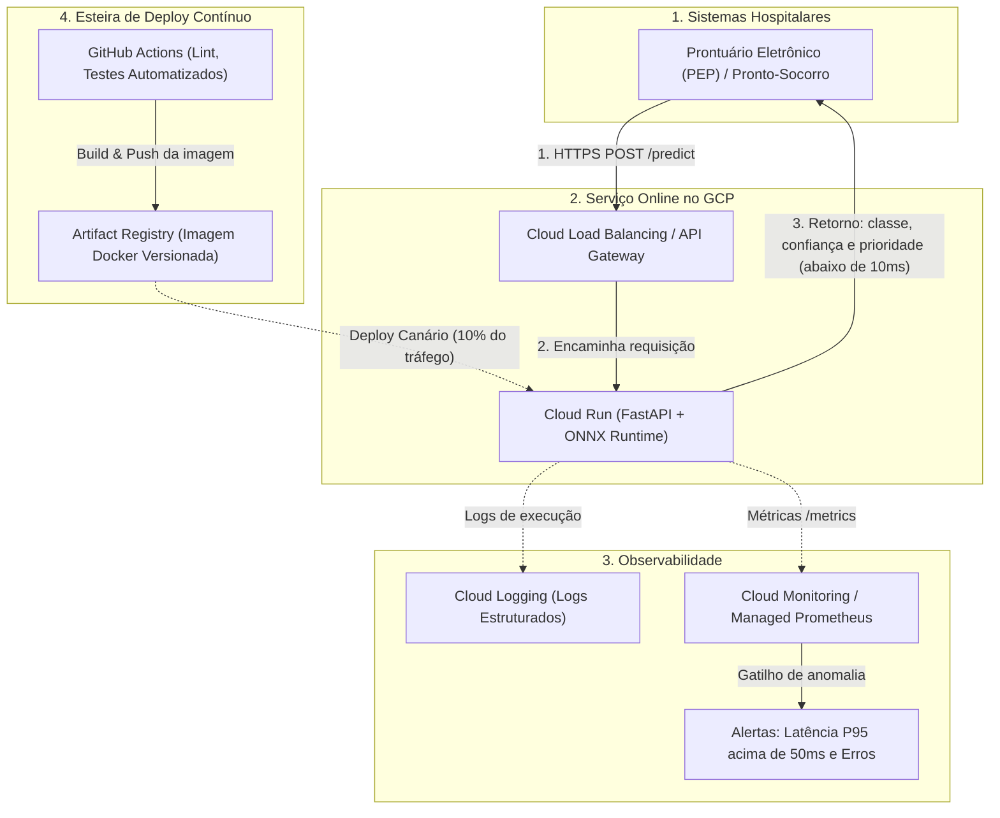
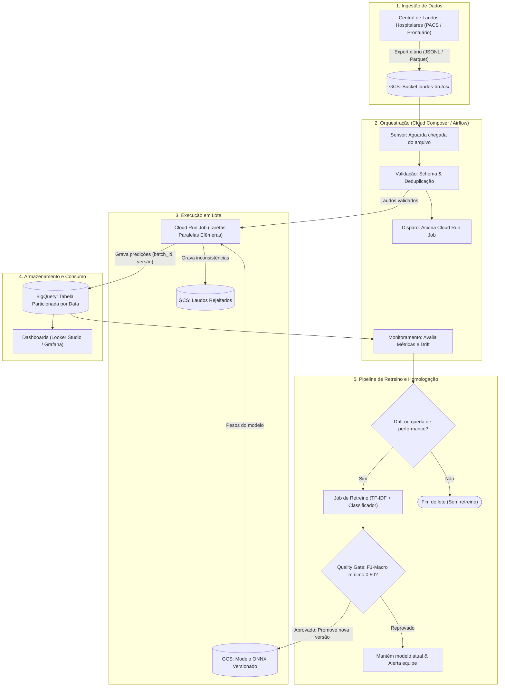
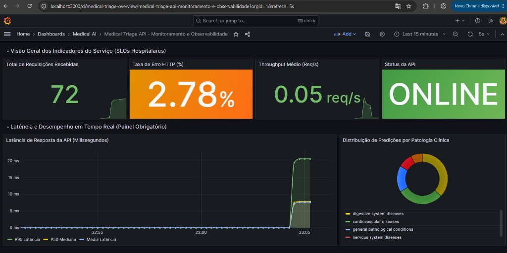
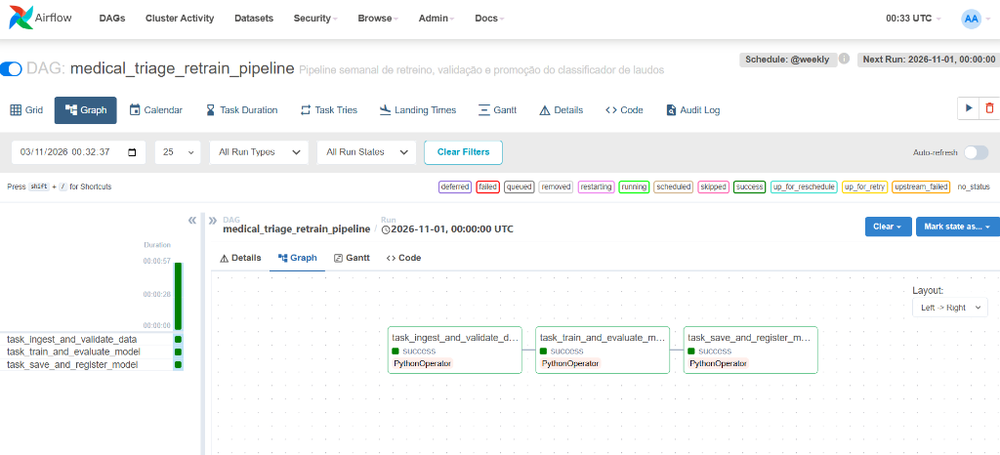

# Tech Challenge - Fase 3 | Machine Learning Engineering (FIAP)
## Deploy de Modelo em Produção: Triagem Automática de Laudos Médicos com NLP

Sistema de triagem automática de laudos e exames médicos textuais para classificação de condições clínicas e urgência hospitalar. O projeto contempla o ciclo de vida completo de MLOps: decisão arquitetural em nuvem, API REST de baixa latência, conteinerização Docker, automação CI/CD (GitHub Actions), orquestração de retreino (Airflow), observabilidade (Prometheus + Grafana) e otimização de latência (ONNX).

---

## 1. Contexto do Desafio e Problema Clínico

Em hospitais e centros de diagnóstico de alta demanda, a triagem manual de laudos clínicos e exames pode gerar gargalos críticos no atendimento. A automação inteligente desse fluxo auxilia a priorizar exames graves (como neoplasias e eventos cardiovasculares agudos) frente a condições eletivas ou gerais.

O modelo é treinado para classificar o texto do laudo (`medical_abstract`) em 5 condições clínicas:
1. **Neoplasms** (Neoplasias / Tumores)
2. **Digestive system diseases** (Doenças do Aparelho Digestivo)
3. **Nervous system diseases** (Doenças do Sistema Nervoso)
4. **Cardiovascular diseases** (Doenças Cardiovasculares)
5. **General pathological conditions** (Condições Patológicas Gerais)

---

## 2. Decisão Arquitetural em Nuvem: Google Cloud Platform (GCP)
 
Conforme a **Etapa 1**, esta seção define a estratégia de deploy em nuvem para o classificador de laudos, comparando **inferência em tempo real (online)** e **inferência em lote (batch)** no ecossistema do GCP.
 
### 2.1. Decisão em Resumo
 
**A triagem de urgência é, por natureza, um problema de tempo real.** O valor clínico do sistema está em priorizar um laudo no momento em que ele é digitado, e não horas depois. Por isso:
 
| Papel | Estratégia | Serviço GCP escolhido |
| :--- | :--- | :--- |
| **Principal (crítico)** | Inferência em tempo real | **Cloud Run** (API FastAPI + ONNX Runtime) |
| **Complementar** | Inferência em lote e retreino | **Cloud Composer (Airflow) + Cloud Run Jobs + BigQuery** |
 
O processamento em lote não substitui o tempo real. Ele atende a necessidades que não exigem resposta imediata: auditoria clínica, controle de qualidade, faturamento e monitoramento de drift para o retreino do modelo.
 
#### Premissas do cenário
 
* **Volume:** milhares de laudos por lote; picos de requisições online em horário de plantão.
* **SLO online:** P95 < 50 ms ponta a ponta (rede + API + inferência) e disponibilidade de 99,9%.
* **Dados sensíveis:** laudos médicos estão sujeitos à LGPD (ver 2.6).
* **Mapeamento condição → prioridade (exemplo a validar com a equipe clínica):** o modelo classifica a condição clínica, e a prioridade operacional é derivada dela por regra de negócio configurável.

| Condição prevista | Prioridade (exemplo) |
| :--- | :---: |
| Cardiovascular diseases | Urgente |
| Neoplasms | Urgente |
| Nervous system diseases | Atenção |
| Digestive system diseases | Atenção |
| General pathological conditions | Normal |
 
---
 
### 2.2. Estratégia 1: Inferência em Tempo Real
 
#### Fluxograma: tempo real
 

 
#### Cenário hospitalar
 
* **Casos de uso:** pronto-socorro, UTI e triagem no momento da digitação do laudo.
* **Requisitos:** latência estrita (P95 < 50 ms ponta a ponta), alta disponibilidade, concorrência variável e retorno imediato de classe, confiança e prioridade.
#### Opções avaliadas
 
| Opção | Pontos fortes | Pontos fracos |
| :--- | :--- | :--- |
| **Cloud Run (recomendada)** | Serverless para contêineres, aproveita o `Dockerfile` do projeto sem alterações, escala automática, integração com Artifact Registry e IAM, divisão de tráfego para deploy canário e rollback rápido | Menos controle fino de rede e topologia do que Kubernetes |
| **GKE** | Controle total (service mesh, autoscaling customizado, topologia de pods) | Complexidade operacional e custo mínimo fixo desproporcionais para um único classificador leve |
| **Vertex AI Endpoints** | Gestão nativa de modelos, monitoramento de drift e explicabilidade | Nó dedicado ativo continuamente, maior curva de empacotamento e custo mínimo mais alto para um modelo desse porte |
 
> **Decisão:** **Cloud Run.** A API já está empacotada em Docker (Etapa 1), e a complexidade operacional do GKE e do Vertex AI não se justifica para o tamanho do modelo.
 
#### Decisões de projeto complementares
 
* **`min-instances ≥ 1` no fluxo crítico.** A escala a zero é atraente para custo, mas introduz *cold start*. Para um serviço de pronto-socorro com meta de 99,9%, mantemos ao menos uma instância ativa. O cold start real deve ser medido no deploy, e não presumido.
* **Modelo embutido na imagem.** O artefato ONNX vai dentro da imagem Docker, então a versão do modelo é a tag da imagem. Isso simplifica rollback e auditoria.
* **Deploy canário.** Nova versão recebe uma fração pequena do tráfego; promove-se ou reverte-se com base nas métricas de latência e erro.
* **Latência medida no projeto:** baseline local de P95 = 5,28 ms (scikit-learn); inferência do modelo com ONNX Runtime de P95 = 0,60 ms (seção 6). A meta de P95 < 50 ms deixa margem confortável para rede, TLS e variação de infraestrutura.
---
 
### 2.3. Estratégia 2: Processamento em Lote (Batch) e Retreino
 
#### Fluxograma: batch
 

 
#### Cenário hospitalar
 
* **Casos de uso:** classificação em massa de laudos dos últimos dias ou semanas para auditoria clínica, controle de qualidade e faturamento; verificação periódica de desempenho; retreino.
* **Requisitos:** bom throughput, baixo custo por amostra, sem resposta síncrona. Meta de exemplo: lote noturno concluído antes das 06h.
#### Opções avaliadas
 
| Opção | Pontos fortes | Pontos fracos |
| :--- | :--- | :--- |
| **Cloud Composer + Cloud Run Jobs (recomendada)** | Airflow gerenciado (atende ao requisito do desafio e mantém paridade com a DAG local); Jobs efêmeros que reaproveitam a imagem Docker; paralelismo por *tasks* | O ambiente Composer fica sempre ativo e tem custo fixo, mesmo sem DAG em execução |
| **Cloud Scheduler / Eventarc + Cloud Run Jobs (alternativa enxuta)** | Custo mínimo e baixa operação; gatilho por horário ou por chegada de arquivo no GCS | Sem a visão de DAG, dependências e histórico de execuções do Airflow |
| **Vertex AI Batch Prediction** | Serviço gerenciado de predição em lote | Exige container no contrato do Vertex; menos flexível para encadear validação, regras de negócio e gravação customizada |
| **BigQuery ML** | Inferência em SQL, ao lado dos dados; permite importar modelos ONNX armazenados no GCS | A compatibilidade com o pré-processamento de texto (TF-IDF) precisa ser validada; separa a lógica do pipeline Python já usado pela API |
| **Dataflow (Apache Beam)** | Escala muito alta e suporte a streaming | Sobredimensionado para milhares de laudos por lote; curva de aprendizado e custo maiores |
 
> **Decisão:** **Cloud Composer (Airflow) + GCS + Cloud Run Jobs + BigQuery.** A escolha prioriza a paridade com o que foi implementado no projeto (a mesma DAG Airflow e a mesma imagem Docker) e a reutilização do modelo ONNX da Etapa 4. Em um cenário em que o custo fixo do Composer não se justifique, **Cloud Scheduler + Cloud Run Jobs** é a alternativa direta, sem mudar o código de inferência.
 
#### Dimensionamento
 
Com o ONNX Runtime, o benchmark do projeto mediu ~2.467 req/s em uma única thread (seção 6). Para 1 milhão de laudos, isso equivale a cerca de 7 minutos em um único worker (1.000.000 ÷ 2.467 ≈ 405 s), sem batching vetorizado. Para o volume esperado (milhares de laudos por lote), **uma única task do Cloud Run Job é suficiente**. O paralelismo fica como caminho de escala: cada task lê as variáveis `CLOUD_RUN_TASK_INDEX` e `CLOUD_RUN_TASK_COUNT` e processa seu próprio shard de arquivos. Esse valor deve ser reconfirmado na configuração de CPU do Cloud Run, pois o benchmark foi local.
 
#### Projeto operacional do lote
 
* **Gatilho:** agendamento (Airflow) ou chegada de arquivo no GCS (sensor).
* **Entrypoint:** a mesma imagem Docker da API, com comando alternativo (ex.: `python -m src.batch.predict_batch --input gs://... --output ...`). Este módulo é parte da proposta e ainda não foi implementado no repositório.
* **Idempotência:** reprocessar um lote não duplica resultados. Usa-se partição por data e `MERGE` por `laudo_id` + `batch_id`.
* **Tratamento de falhas:** retries automáticos no Job e na task do Airflow; laudos inválidos ou vazios são desviados para a área de rejeitados, sem derrubar o lote.
* **Rastreabilidade:** cada predição é gravada com `model_version` e `processed_at`, essencial em contexto clínico e para auditoria.
* **Schema de saída (BigQuery):** `laudo_id`, `classe_predita`, `confianca`, `prioridade`, `model_version`, `batch_id`, `processed_at`.
* **Monitoramento do batch:** duração do lote, taxa de rejeição e distribuição de classes ao longo do tempo (sinal de drift que pode disparar retreino).
* **Retreino com gate de qualidade:** o modelo candidato só substitui o atual se superar a métrica de referência no conjunto de validação (por exemplo, F1 macro); caso contrário, a equipe é alertada.
---
 
### 2.4. Matriz de Decisão Comparativa
 
| Critério | Tempo real (Cloud Run) | Batch (Composer + Cloud Run Jobs) |
| :--- | :---: | :---: |
| **Gatilho** | Requisição HTTP síncrona | Agendamento ou chegada de arquivo no GCS |
| **Latência esperada** | P95 < 50 ms ponta a ponta (modelo ONNX < 1 ms) | Segundos a minutos por lote (foco em throughput) |
| **Escala** | Automática por requisição, com mínimo de 1 instância ativa | Por tasks paralelas do Job, só durante a execução |
| **Custo fixo** | Instância mínima ativa | Ambiente Composer ativo (ou nenhum, se usar Scheduler) |
| **Destino dos dados** | Resposta JSON ao cliente | BigQuery, para analytics e BI |
| **Orquestrador** | Load Balancing / API Gateway | Cloud Composer (Airflow) |
| **Falha típica e tratamento** | Retry no cliente; alerta por erro e latência | Retry de task; rejeitados em área separada |
 
---
 
### 2.5. Arquitetura Integrada: do Ambiente Local à Nuvem
 
O projeto foi implementado e validado localmente. A tabela a seguir mostra como cada componente se traduz para o GCP e o que é implementação versus proposta.
 
| Função | No projeto (implementado) | Em produção (GCP) |
| :--- | :--- | :--- |
| API de inferência | FastAPI em Docker | Cloud Run |
| Modelo otimizado | `model_optimized.onnx` + ONNX Runtime | Mesmo artefato, embutido na imagem |
| Orquestração | DAG Airflow local (`dags/medical_retrain_dag.py`) | Cloud Composer |
| Execução do lote | Funções em `src/pipelines/` | Cloud Run Jobs (proposta) |
| Armazenamento de dados | Arquivos em `raw_data/` | GCS + BigQuery (proposta) |
| Métricas e dashboards | Prometheus + Grafana (Docker Compose) | Cloud Monitoring / Managed Prometheus, ou Grafana |
| CI | GitHub Actions: lint, testes, build | Idem |
| CD | Não implementado | GitHub Actions → Artifact Registry → Cloud Run (proposta) |
 
**CI/CD proposto.** Todo `push` na `main` executa lint e testes, constrói a imagem e a publica no Artifact Registry. O deploy no Cloud Run é feito com tráfego canário. A autenticação com o GCP usa **Workload Identity Federation**, sem chaves JSON armazenadas no repositório.
 
**Observabilidade.** A API expõe `/metrics` (`prometheus-client`). Localmente, Prometheus e Grafana fazem coleta e visualização. Na nuvem, as mesmas métricas podem ser consumidas pelo Cloud Monitoring.
 
---
 
### 2.6. Segurança e Conformidade (LGPD)
 
* **Região:** `southamerica-east1` (São Paulo), mantendo os dados em território nacional.
* **Acesso:** IAM com menor privilégio e contas de serviço distintas para API, Job e Composer.
* **Minimização de dados:** de-identificação (por exemplo, Cloud DLP) antes de gravar laudos no BigQuery; a API não deve persistir o texto do laudo em logs.
* **Criptografia:** em trânsito (HTTPS) e em repouso (padrão do GCP, com chaves gerenciadas pelo cliente se exigido).
* **Rede:** acesso privado entre o sistema hospitalar e a API (VPN/Interconnect ou ingress restrito), conforme a política do hospital.
---
 
### 2.7. Limitações e Próximos Passos
 
* A arquitetura em nuvem é **uma proposta documental**, conforme o escopo da Etapa 1; o que roda de fato é a stack local (API, Airflow, Prometheus/Grafana).
* O módulo `src/batch/predict_batch.py` e o deploy contínuo no Cloud Run são os próximos passos naturais.
* A latência em nuvem (incluindo cold start e rede) deve ser medida após o primeiro deploy e comparada ao baseline local.
* O mapeamento condição → prioridade deve ser validado por especialistas clínicos antes de uso real.
 
---

## 3. Estrutura do Repositório

```text
├── .github/
│   └── workflows/          # Workflows CI/CD (lint, testes, build)
│       └── ci.yml
├── dags/                   # DAGs do Apache Airflow
│   └── medical_retrain_dag.py # Pipeline de ingestão, retreino e promoção
├── docs/                   # Documentação complementar e diagramas
├── models/
│   ├── baseline_model.joblib  # Pipeline treinado (TF-IDF + Classificador)
│   └── classes_mapping.json   # Metadados e mapeamento de categorias
├── monitoring/             # Stack de Observabilidade e Métricas
│   ├── grafana/
│   │   ├── dashboards/     # Dashboard JSON com os 3 painéis obrigatórios
│   │   │   └── medical_triage_dashboard.json
│   │   └── provisioning/   # Configuração automática do datasource e dashboards
│   │       ├── dashboards/dashboard_provider.yml
│   │       └── datasources/prometheus_datasource.yml
│   └── prometheus/
│       └── prometheus.yml  # Configuração de scraping da API a cada 5s
├── notebooks/
│   └── eda.ipynb           # Análise Exploratória e Modelagem de NLP
├── raw_data/
│   ├── medical_tc_labels.csv  # Mapeamento oficial dos rótulos clínicos
│   ├── medical_tc_train.csv   # Dataset de treino (11.550 amostras)
│   └── medical_tc_test.csv    # Dataset de teste (2.888 amostras)
├── src/
│   ├── __init__.py
│   ├── api/                # Serviço REST com FastAPI
│   │   ├── __init__.py
│   │   ├── config.py       # Configurações de ambiente e aplicação
│   │   ├── metrics.py      # Instrumentação de telemetria Prometheus
│   │   ├── model.py        # Serviço desacoplado de inferência
│   │   ├── schemas.py      # Schemas Pydantic de entrada e saída
│   │   └── main.py         # Endpoints FastAPI e ciclo de vida
│   └── pipelines/          # Módulos de engenharia de dados e retreino
│       ├── __init__.py
│       └── training_pipeline.py # Funções desacopladas do pipeline de ML
├── tests/                  # Testes automatizados e benchmarks
│   ├── __init__.py
│   ├── benchmark_latency.py # Script de medição de latência local
│   ├── generate_traffic.py  # Gerador de tráfego para teste do Grafana
│   ├── latency_baseline.json# Registro das métricas de latência
│   ├── test_airflow_dag.py  # Teste end-to-end do pipeline da DAG
│   └── test_api.py         # Testes de integração dos endpoints
├── .dockerignore           # Exclusão de arquivos pesados na imagem
├── .gitignore
├── config.yaml             # Configurações gerais da aplicação
├── docker-compose.yml      # Stack completa: API + Prometheus + Grafana
├── Dockerfile              # Empacotamento Docker da API (não-root)
├── requirements.txt        # Dependências do projeto
└── README.md               # Documentação técnica e arquitetural
```

---

## 4. Como Executar o Projeto Localmente

### 4.1. Pré-requisitos
* Python 3.10+ instalado
* Git instalado
* Docker e Docker Compose instalados

### 4.2. Instalação do Ambiente Virtual
```bash
# Clonar o repositório
git clone <url-do-repositorio>
cd fase3

# Criar ambiente virtual
python -m venv .venv

# Ativar ambiente (Windows)
.venv\Scripts\activate
# Ativar ambiente (Linux/Mac)
source .venv/bin/activate

# Instalar dependências
pip install -r requirements.txt
```

### 4.3. Executando a Análise Exploratória (Notebook)
```bash
jupyter notebook notebooks/eda.ipynb
```

### 4.4. Executando a API FastAPI Localmente
```bash
uvicorn src.api.main:app --host 0.0.0.0 --port 8000 --reload
```
Acesse a documentação interativa OpenAPI (Swagger) em: [http://localhost:8000/docs](http://localhost:8000/docs).

### 4.5. Executando os Testes Automatizados
```bash
# Executa todos os testes (API e pipeline da DAG)
pytest tests/ -v

# Ou via unittest
python -m unittest tests/test_api.py -v
python -m unittest tests/test_airflow_dag.py -v
```

### 4.6. Medindo o Baseline de Latência Local
```bash
python tests/benchmark_latency.py --requests 300
```

### 4.7. Construção e Execução via Docker
```bash
# Construir a imagem Docker leve da API
docker build -t medical-triage-api:v1 .

# Executar o container expondo a porta 8000
docker run -d -p 8000:8000 --name triage-api medical-triage-api:v1

# Testar o status de saúde do container
# Linux/Mac (Bash):
curl http://localhost:8000/health
# Windows (PowerShell):
Invoke-RestMethod http://localhost:8000/health

# Testar inferência via container
# Opção A: Windows PowerShell (Nativo)
$body = @{
    medical_abstract = "Patient admitted with severe chest pain, elevated cardiac enzymes and ST-segment elevation on ECG confirming acute myocardial infarction."
} | ConvertTo-Json

Invoke-RestMethod -Uri http://localhost:8000/predict -Method Post -Body $body -ContentType "application/json"

# Opção B: Linux/Mac (Bash / cURL)
curl -X POST http://localhost:8000/predict \
     -H "Content-Type: application/json" \
     -d '{"medical_abstract": "Patient admitted with severe chest pain, elevated cardiac enzymes and ST-segment elevation on ECG confirming acute myocardial infarction."}'
```

### 4.8. Executando a Stack de Observabilidade Completa (API + Prometheus + Grafana)
A stack oficial da **Etapa 3** sobe a aplicação instrumentada com coleta de métricas e dashboards pré-configurados:

```bash
# 1. Subir toda a stack em segundo plano
docker compose up -d

# 2. Gerar requisições clínicas sintéticas para alimentar os gráficos do Grafana
python tests/generate_traffic.py

# 3. Acessar os serviços no navegador:
# - API FastAPI:    http://localhost:8000/docs
# - Métricas raw:   http://localhost:8000/metrics
# - Prometheus UI:  http://localhost:9090
# - Grafana UI:     http://localhost:3000 (Login: admin / Senha: admin)
```

#### Evidências Visuais de Execução
Abaixo estão os registros visuais das ferramentas em execução durante a validação da solução:

**1. Dashboard de Monitoramento no Grafana (Etapa 3):**


**2. Pipeline de Retreino no Apache Airflow (Etapa 2):**


---

## 5. Baseline de Latência Local (Etapa 1)

Medição realizada sobre 300 requisições individuais com amostras reais do conjunto de teste (`medical_tc_test.csv`):

| Métrica de Performance | Valor Medido | Observações |
| :--- | :---: | :--- |
| **Total de Requisições** | 300 | Amostras variadas de laudos clínicos |
| **Taxa de Sucesso / Erro** | 100% / 0.0% | Sem quedas ou exceções durante o benchmark |
| **Throughput Médio** | **261.27 req/s** | Capacidade de resposta em thread síncrona local |
| **Latência Média** | **3.68 ms** | Tempo total de ciclo (rede local + parsing + inferência) |
| **Latência P50 (Mediana)** | **3.44 ms** | Tempo de resposta para 50% dos laudos |
| **Latência P90** | **4.71 ms** | Percentil 90 |
| **Latência P95** | **5.28 ms** | Percentil 95 (referência para SLO hospitalar) |
| **Latência P99** | **8.35 ms** | Percentil 99 |
| **Latência Mínima / Máxima**| 2.16 ms / 13.92 ms | Sem spikes representativos de cold start |

---

## 6. Otimização de Latência: Scikit-Learn vs. ONNX Runtime (Etapa 4)

Conforme a **Etapa 4**, o classificador de texto foi exportado para o formato padrão da indústria **ONNX** (`models/model_optimized.onnx`) e executado através do runtime compilado em C++ **ONNX Runtime (CPUExecutionProvider)**.

O benchmark comparativo oficial avaliou **500 laudos clínicos reais** sob as mesmas condições de CPU:

| Métrica de Desempenho | Scikit-Learn (Original) | ONNX Runtime (Otimizado) | Melhoria Alcançada |
| :--- | :---: | :---: | :---: |
| **Latência Média** | **2.912 ms** | **0.402 ms** | **7.24x mais rápido (-86.2%)** |
| **Latência Mediana (P50)**| **2.895 ms** | **0.418 ms** | **6.93x mais rápido (-85.6%)** |
| **Latência P90** | **3.787 ms** | **0.513 ms** | **7.38x mais rápido (-86.5%)** |
| **Latência P95 (SLO)** | **4.010 ms** | **0.598 ms** | **6.71x mais rápido (-85.1%)** |
| **Latência P99** | **4.370 ms** | **0.739 ms** | **5.91x mais rápido (-83.1%)** |
| **Throughput Máximo** | **342.7 req/s** | **2.467.4 req/s** | **+2.124 req/s (+620%)** |
| **Paridade de Predição** | Referência | **100.0%** | Sem perda de acurácia clínica |

> Os dados brutos do benchmark comparativo estão documentados em [`docs/latency_comparison.json`](docs/latency_comparison.json).

### Como Reproduzir a Otimização e o Benchmark:
```bash
# 1. Exportar o modelo para ONNX
python src/optimization/onnx_converter.py

# 2. Executar o benchmark comparativo oficial
python scripts/benchmark_comparison.py

# 3. Executar os testes de validação do ONNX
python -m unittest tests/test_onnx.py -v
```

---

## 7. Roteiro do Vídeo de Apresentação (Método STAR)

O roteiro oficial estruturado para o vídeo de até 5 minutos está disponível em:  
👉 [**`docs/roteiro_video_star.md`**](docs/roteiro_video_star.md)

* **Situation (1 min):** Desafio clínico da triagem rápida de laudos em emergências hospitalares.
* **Task (1 min):** Requisitos técnicos (CI/CD, Airflow, Docker, Prometheus/Grafana, ONNX).
* **Action (2 min):** Demonstração da API, testes no GitHub Actions, DAG do Airflow e Dashboard no Grafana.
* **Result (1 min):** Apresentação dos resultados e ganho de 7.24x de velocidade com ONNX Runtime.

---

## 8. Roadmap de Entregas (Tech Challenge - 100% Concluído)

- [x] **Análise Exploratória e Modelagem:** EDA completa, limpeza de jargão clínico, balanceamento de classes e serialização do modelo base leve.
- [x] **Decisão Arquitetural em Nuvem:** Documentação detalhada para GCP (Batch vs. Real-time) no `README.md`.
- [x] **Etapa 1 - API Inicial e Docker:** Criação da API FastAPI modular (`src/api/`), `Dockerfile` com boas práticas de segurança (não-root) e medição do baseline de latência local.
- [x] **Etapa 2 - CI/CD e Orquestração:** Pipeline de automação no GitHub Actions (`.github/workflows/ci.yml`) com lint e testes, e DAG do Apache Airflow (`dags/medical_retrain_dag.py`) com pipeline modular (`src/pipelines/training_pipeline.py`).
- [x] **Etapa 3 - Observabilidade:** Instrumentação de métricas com `prometheus-client` (`/metrics`), Docker Compose unificando API + Prometheus + Grafana, e Dashboard provisionado com os 3 painéis obrigatórios (Requisições, Latência e Taxa de Erro).
- [x] **Etapa 4 - Otimização de Latência:** Conversão do modelo para **ONNX Runtime** (`models/model_optimized.onnx`), ganho de 7.24x de velocidade demonstrado e roteiro estruturado para o vídeo STAR (`docs/roteiro_video_star.md`).

